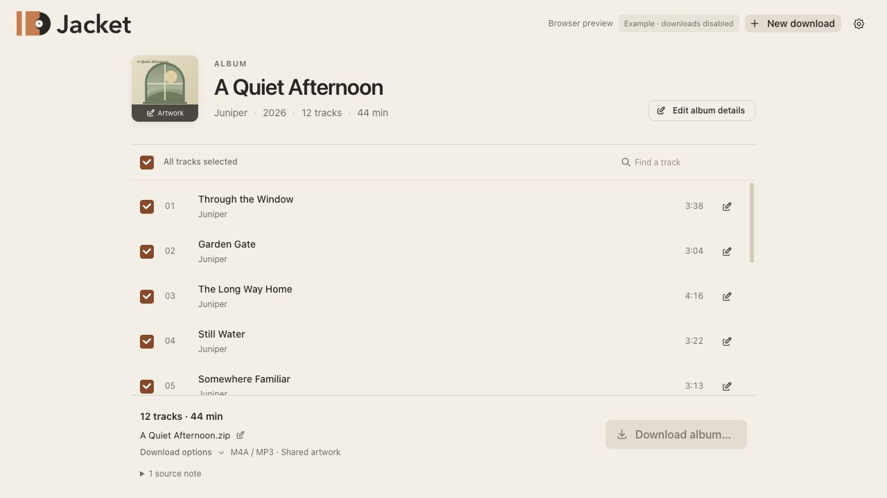
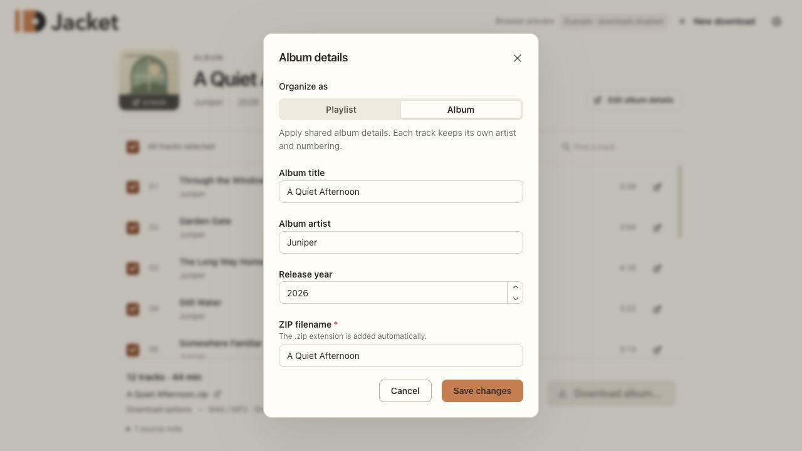

<p align="center">
  <picture>
    <source media="(prefers-color-scheme: dark)" srcset="branding/jacket/svg/jacket-logo-dark.svg">
    
  </picture>
</p>

<p align="center"><strong>From link to neatly packed.</strong><br>Turn YouTube albums and playlists into tagged audio, artwork, and a playlist—together in one ZIP.</p>

<p align="center">
  <a href="#get-started">Get started</a> ·
  <a href="docs/usage.md">User guide</a> ·
  <a href="CONTRIBUTING.md">Contribute</a> ·
  <a href="LICENSE">GPLv3 or later</a>
</p>



*The screenshots use Jacket’s built-in fictional example album. Browser preview downloads are disabled.*

Jacket is a focused desktop app from [Moonlark Studios](https://github.com/MoonlarkStudios). Paste a YouTube or YouTube Music link, review the tracks and album details, and save a portable archive. Downloads and tagging run on your computer.

## What you can do

- **Review before downloading.** Select tracks, search a playlist, and correct titles, artists, album details, track numbers, disc numbers, and release years.
- **Keep albums organized.** Apply shared album metadata and artwork, or keep each playlist track’s own details. Repeated entries stay in order.
- **Choose your audio format.** Use M4A / MP3 for compatibility, preserve supported source codecs, or choose MP3 throughout.
- **Take the whole package.** Get tagged audio, available artwork, an M3U playlist, and a manifest with source details and file hashes.
- **Recover interrupted downloads.** Retry with completed source downloads cached, or reopen Jacket to resume an unfinished export.
- **Use public links without signing in.** Optionally select a browser profile for content your account can access.

## Get started

**Jacket is an early source release.** Signed, notarized installers and automatic whole-app updates are not configured yet. The current macOS packaging target is **Apple Silicon on macOS 26 or later**. Windows, Linux, Intel Macs, and older macOS versions have not been validated for release.

### Run the desktop app from source

On macOS, install [Homebrew](https://brew.sh), [mise](https://mise.jdx.dev/getting-started.html), and Xcode Command Line Tools (`xcode-select --install`). See [Tauri’s prerequisites](https://v2.tauri.app/start/prerequisites/) for native build requirements.

```sh
git clone https://github.com/MoonlarkStudios/jacket.git
cd jacket
mise trust
mise install
mise run setup
mise run desktop
```

Setup installs the project’s locked frontend dependencies and test tools. On macOS, it also installs missing FFmpeg and yt-dlp Homebrew packages. The project pins its Node.js, Rust, Python, and uv versions; run project commands through mise.

For a local macOS app bundle:

```sh
mise run package:mac
```

Open `target/release/bundle/macos/Jacket.app`. The bundle includes its audio tools, so it does not need separate runtime installations. Local bundles are ad-hoc signed; [public distribution still needs additional work](docs/tool-bundling.md#distribution-prerequisites).

### Just explore the interface

```sh
mise run dev
```

Open `http://127.0.0.1:1420` and choose **Try example**. This preview lets you explore selection, artwork, and metadata editing. Inspecting real links and saving audio require the desktop app.

## Your first download

1. Paste an HTTPS YouTube playlist, video, or YouTube Music album link into Jacket.
2. Review the available tracks. Choose **Edit album details**, click a track’s edit button, or click the cover to change artwork.
3. Open **Download options** to choose the format and artwork behavior.
4. Choose **Download album…** or **Download playlist…**, then pick where to save the ZIP.
5. When the archive is ready, reveal it in your file manager and extract it into your music folder.

Existing archives are kept. If the filename is already taken, Jacket saves a numbered copy. Unavailable entries are reported before download; artwork failures produce a warning while allowing audio export to continue.

<details>
<summary>See album editing</summary>



</details>

## What’s in the ZIP?

```text
My Album/
├── 01 - First Track.mp3
├── 02 - Second Track.mp3
├── cover.jpg
├── playlist.m3u
└── manifest.json
```

The exact contents depend on your choices. Per-track artwork goes in `artwork/`; choosing no artwork omits images. `playlist.m3u` uses relative paths, so the extracted folder can move with your music. The [manifest format](docs/manifest.md) records original and exported metadata, codecs, warnings, and SHA-256 hashes.

| Format option | Result |
| --- | --- |
| **M4A / MP3** | Keeps AAC and ALAC audio in M4A; converts other codecs to MP3 when needed. |
| **Keep source codec** | Preserves supported AAC, ALAC, MP3, Opus, Vorbis, FLAC, or PCM audio without re-encoding the audio stream. |
| **MP3** | Produces MP3 files; existing MP3 audio is copied without re-encoding. |

Preserving a codec retains the quality available from the source; it does not make lossy audio lossless. Artwork may be a video thumbnail. WAV has limited tag support and uses separate artwork; Jacket reports metadata it cannot embed.

## Privacy and browser access

Jacket has no application server or telemetry. It contacts YouTube and its image servers for source content, and GitHub for optional yt-dlp updates. **Automatic downloader updates are on by default** and can be paused in **Settings → Audio downloader**; they update yt-dlp separately from Jacket.

Public access is the default. For account-restricted content, open **Settings → Browser session**, select an installed browser and exact profile, and choose **Use this session**. Jacket reads that browser session locally through yt-dlp. Cookies are never included in archives, manifests, or recovery records. New work starts with public access after an app restart; resuming an unfinished job retains its explicit browser selection.

Failed or cancelled exports keep downloaded media and recovery details in the local app cache. Successful exports remove their job cache. There is no cache-cleanup screen yet. See the [user guide](docs/usage.md#local-data-and-cleanup) for locations and cleanup instructions.

## Need help?

- **A link stopped working:** check **Settings → Audio downloader → Check now**, then retry. YouTube changes independently of Jacket.
- **A link needs your account:** select the browser profile where you can play it, then use **Test access**. A passing public link does not prove access to private content.
- **A download was interrupted:** reopen Jacket and choose **Resume download**. See [recovery and troubleshooting](docs/usage.md#interrupted-downloads).
- **Something else went wrong:** [report an issue](https://github.com/MoonlarkStudios/jacket/issues/new/choose) with your app version, operating system, and reproduction steps. Remove private URLs, account details, and local paths from anything you share. Report security issues through [the security policy](SECURITY.md).

Download only content you own or have permission to download, and follow the source service’s terms. Jacket does not bypass DRM or grant access to restricted content. It is not affiliated with YouTube or Google.

## Development and contributing

Built with Tauri 2, Rust, React, TypeScript, and Mantine. The reusable audio engine is independent of Tauri; the desktop layer owns native dialogs, jobs, browser-profile resolution, and recovery.

```sh
mise run check       # Formatting, lint, strict types, UI build, and unit tests
mise run test:media  # Offline audio integration tests with FFmpeg and Mutagen
```

See [CONTRIBUTING.md](CONTRIBUTING.md), [implementation notes](docs/implementation.md), [desktop behavior](docs/desktop-experience.md), and [tool bundling](docs/tool-bundling.md). The [release review](docs/release-readiness.md) tracks remaining distribution work. The [brand kit](branding/jacket/README.md) contains the logo and icon sources.

## License

Copyright © 2026 Moonlark Studios. Jacket is free software under the [GNU General Public License, version 3 or later](LICENSE). Third-party dependencies and bundled audio tools retain their own licenses; see [third-party notices](THIRD_PARTY_NOTICES.md).
