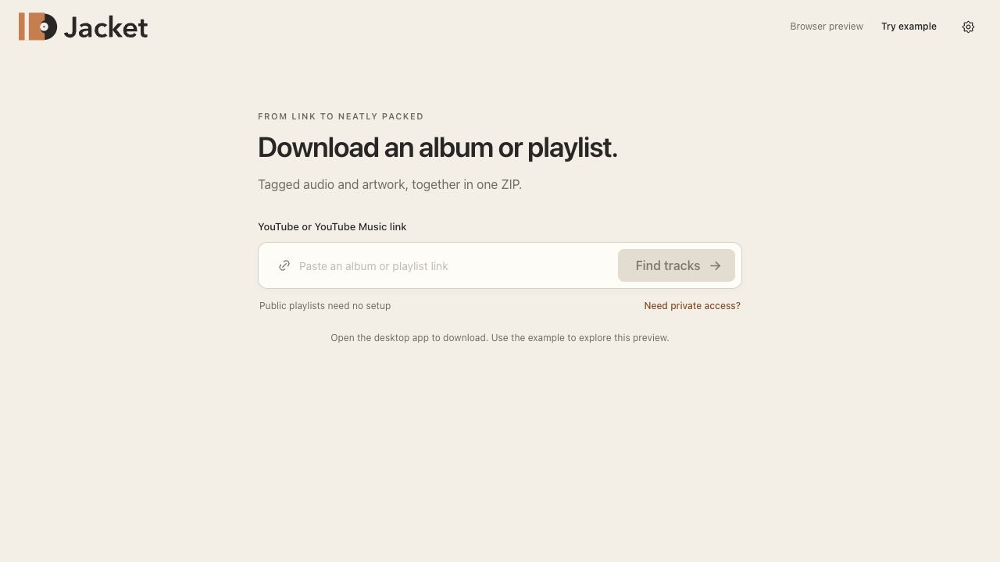
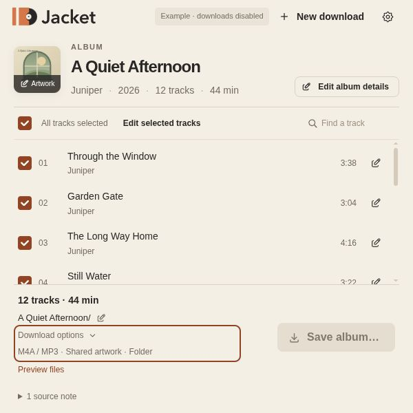
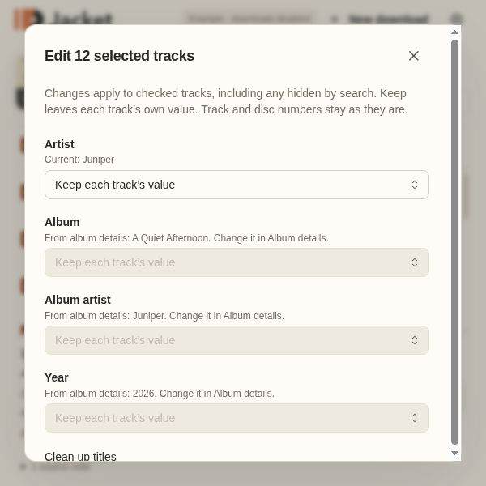
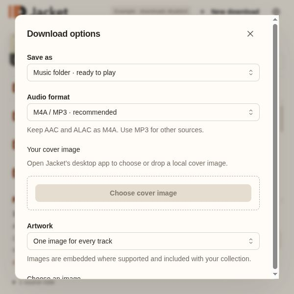

# Jacket screenshots

These are the current screenshots for the README and user documentation. Album views use the built-in fictional **A Quiet Afternoon** album by **Juniper**, including its local example artwork. The browser preview is labeled and cannot download media.

## Start

## Review

## Album details

## Finish an album

The collection-finishing workflow at the 600 × 600 minimum window size:

## Updating screenshots

Run `mise run dev`, open `http://127.0.0.1:1420`, and choose **Try example**. Capture the actual interface with the example label visible. Keep real account names, browser sessions, personal file paths, commercial album artwork, and live provider links out of documentation screenshots. Use this folder’s images when adding screenshots elsewhere in the docs.

These images illustrate the interface; they do not represent completed downloads or native acceptance-test evidence.
