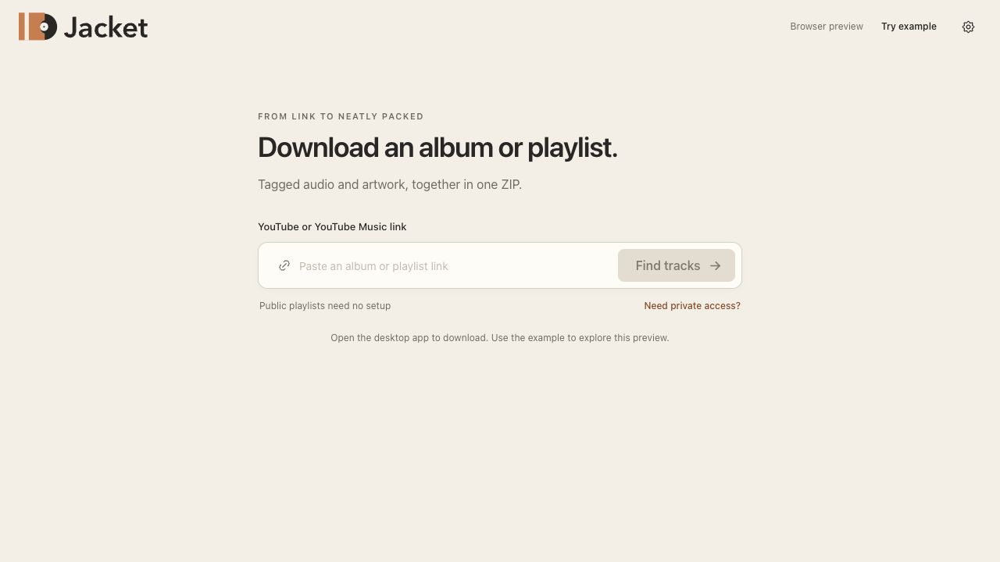
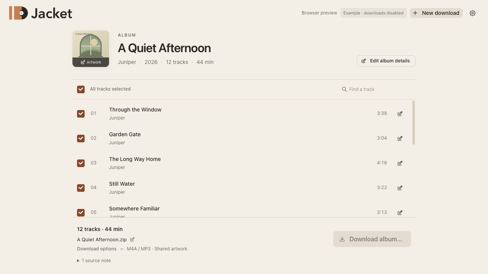
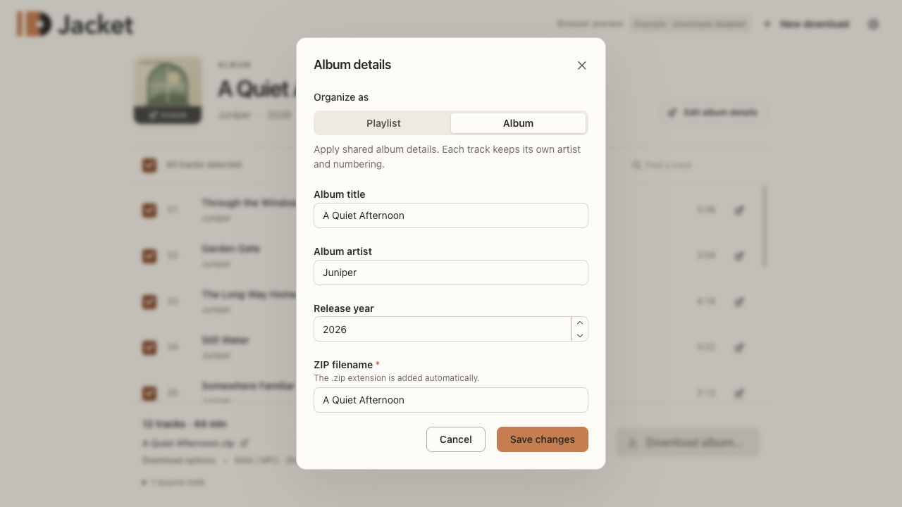
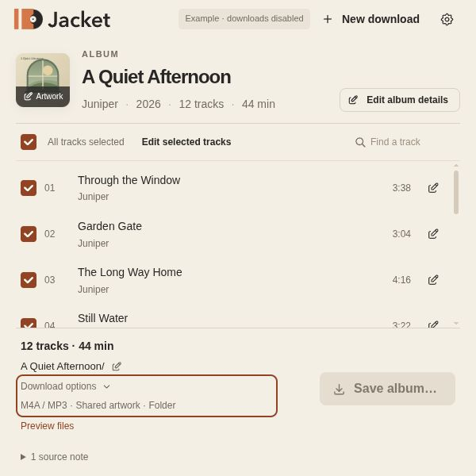
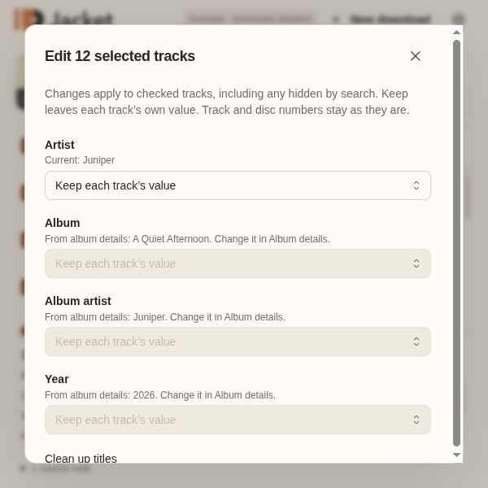
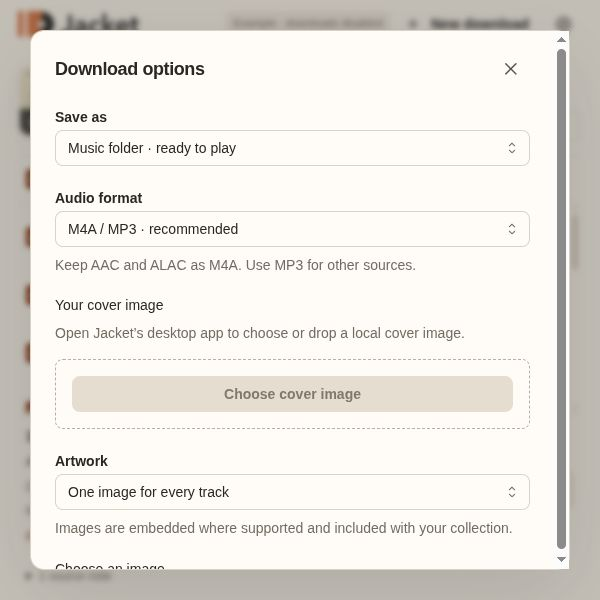

# Jacket screenshots

These screenshots show the earlier album interface used in the README and user documentation. They need a refresh for the song review and folder defaults described in the [product direction](../product-direction.md). Album views use the built-in fictional **A Quiet Afternoon** album by **Juniper**, including its local example artwork. The browser preview is labeled and cannot download media.

## Start

## Review

## Album details

## Finish an album

The collection-finishing workflow at the 600 × 600 minimum window size:

## Updating legacy screenshots

Run `mise run legacy:preview`, open the Vite URL printed in the terminal, and choose **Try a song** or **Explore an album**. Capture the actual interface with the example label visible. Include song review, the combined-link scope choice, and the 600 × 600 minimum window. Keep real account names, browser sessions, personal file paths, commercial album artwork, and live provider links out of documentation screenshots. Use this folder’s images when adding screenshots elsewhere in the docs.

These images illustrate the interface; they do not represent completed downloads or native acceptance-test evidence.

## Native review images

The following captures use isolated fictional content from the native iced app
on Linux/Wayland. Downloads are deliberately disabled in these examples.

- `native-song-dark.png`: focused song metadata and cover controls in Jacket Dark.
- `native-album-compact-light.png`: album review at 600 × 600 in Jacket Light.
- `native-export-preview-dark.png`: selected album artwork, effective tags and
  file layout before folder export.

These images include the filtered artwork preview correction. Regenerate broad
qualification captures with `mise run qualify:ui`; see the native workflow and
artwork-quality records for test evidence and remaining platform acceptance.
