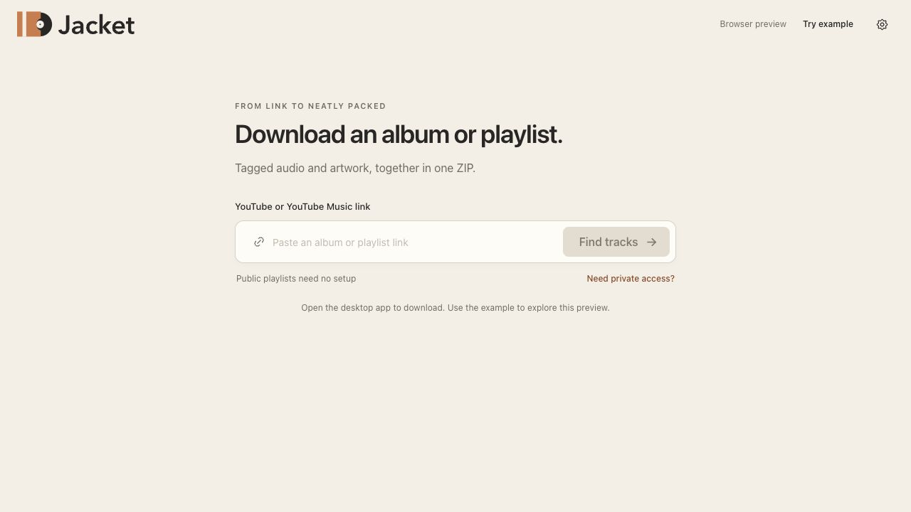

> **Legacy implementation reference.** This document describes the retained React/Tauri app. For the Rust and iced branch, use the [current README](../README.md) and [native port guide](native-port.md). Old installer and acceptance results do not qualify the native app.

# Using Jacket

[Back to the README](../README.md)

## Find tracks

Open the desktop app and paste an HTTPS YouTube or YouTube Music link. Jacket supports individual songs and videos, playlists, and YouTube Music albums. Pasting a complete link starts inspection unless it offers a song/playlist choice. When typing, press Enter or choose **Find tracks**.

A link containing both a video and a playlist offers **This song** and **Entire playlist** by the link field. **This song** is selected initially; choose the scope you want, then press Enter or choose **Find tracks**. A playlist-only link inspects its ordered entries.

Tracks appear as inspection progresses. Wait for inspection to finish before editing or downloading. Unavailable or incomplete entries are reported. If you cancel or inspection fails, the partial preview stays visible; choose **Inspect again** to retry.

The browser preview offers **Try a song** and **Explore an album** to demonstrate the interface. Both use fictional music. It cannot inspect real sources or export audio.

## Review a song or collection

A single recording gets a song-focused review. Check its title, artist, album, and release year, then choose **Edit song details** to correct them. Album and year may be empty. Jacket preserves available source metadata, including track and disc numbers; downloading one song does not remove its album context.

Choose the tracks you want. Search appears for sources with more than eight tracks, and matches title, artist, and album. Playlist order and repeated entries are retained.

For a collection, **Edit album details** (or **Edit details** for a playlist) opens a draft for organization and export name, with shared album title, album artist, and release year available in Album organization. Choose **Save changes** to apply it. Cancel, Escape, and closing the dialog discard the draft. The export name follows the album title until you give it a custom name; it names the music folder or ZIP without changing track tags.

- **Album** organization applies supplied shared album, album artist, and year values. Each track retains its own artist and track/disc numbers. Missing track numbers are filled from source order within each disc; deselecting tracks leaves gaps.
- **Playlist** organization keeps individual music metadata. File-order prefixes do not invent track-number tags.

Use a track’s edit button to correct its title, artist, or other fields. Inherited values are labeled **From album details**. Shared album values take precedence at export; use the editor’s album-details action when you need to change those. **Save & next** continues to the next track.

**Edit selected tracks** changes checked tracks, including those hidden by search. For each field, choose Keep, Set, or Clear. Fields supplied by Album details are shown as inherited; change those in Album details. Prefix/suffix cleanup removes only the exact text you supply, with a before/after preview. Empty resulting titles are rejected. **Undo edits** restores the last bulk change; original source metadata remains available in the manifest.

The desktop app saves committed unfinished reviews locally after selection, metadata, artwork, and preference changes. **Review saved on this device** confirms persistence. Reopening restores the review without signing into a browser. Metadata forms commit with Save; a cropped cover commits with Apply cover. Closing an unfinished metadata or crop form retains the previous values. Starting a new download keeps the last saved review until a new source finishes inspection. **Discard review** removes its saved review and dismisses any associated export recovery. Interrupted exports take priority at startup. Newer saved edits for that same source are retained when resuming. If a different saved review also exists, **Continue saved review** opens it publicly and dismisses the unfinished export; its cached media remain available on disk.

Unknown artists and years stay unknown. Jacket does not treat uploaders as music artists or upload dates as release years. Recognized YouTube Music albums may supply a verified album-header year; review it before exporting.

## Choose artwork and format

Click the cover to review source-image candidates or choose no artwork. Source images may be video thumbnails rather than official album covers. You can use a shared cover or each track’s own image. **Choose cover image** or drop a JPEG/PNG while the Artwork dialog is open. Adjust the square crop with the size and position controls, then choose **Apply cover**. Jacket stores a private copy, so moving or deleting the original image does not affect the review or export. Cancel crop keeps the previous cover. Images must be under 10 MiB and at most 40 megapixels, with neither side over 16,384 pixels. External cover searches are not implemented.

**Download options** contains the format choice:

| Option | Behavior |
| --- | --- |
| M4A / MP3 | Keeps AAC/ALAC in M4A; otherwise copies existing MP3 or converts to MP3. |
| Keep source codec | Copies supported AAC, ALAC, MP3, Opus, Vorbis, FLAC, and PCM audio into a suitable container. Unsupported codecs require another preset. |
| MP3 | Copies MP3 sources; converts other audio to MP3. |

MP3, M4A, FLAC, Opus, and Ogg Vorbis support embedded artwork. WAV cannot embed artwork, and its limited tags omit album artist and disc number. Folder and ZIP output retain a separate image and manifest; Audio file output reports these omissions without creating extra files. Choose M4A / MP3 to include the cover and those tags in one file. Changing containers or metadata does not improve the source audio quality.

## Preview and save your music

**Preview files** shows the planned files, effective requested tags, and artwork. For M4A / MP3 and Keep source codec, extensions remain provisional until the source codec is known. Some containers support fewer embedded tags; export notes report the actual result.

New song reviews use **Audio file**: one tagged recording with artwork embedded when available, without an extra directory, image, playlist, or manifest. Choose a destination folder; Jacket saves the audio directly inside it and adds its actual codec extension after download. Change **Export name** to rename it without changing its tags; enter the name without a format extension.

Albums and playlists default to **Music folder**. **Download options → Save as** also offers **ZIP archive** and **Audio file** when exactly one track is selected, including a track selected from an album. Its album metadata and numbering remain intact. File output requires one selected track; selecting more tracks keeps your output preference and asks you to select one track or choose a folder/ZIP. Saved reviews and unfinished exports retain their chosen output kind.

ZIP export opens a native save dialog. Folder export asks for a parent music folder and creates a named folder inside it. Cancelling a destination dialog starts no download. Existing files and folders are preserved; collisions receive a numbered suffix.

Progress shows prepared tracks and the current operation. Publishing the collection is a separate stage. Folder export provides **Open folder** and **Open playlist** immediately. For a ZIP, reveal the archive in your file manager and extract it before opening `playlist.m3u` with a player that supports the exported audio formats. Keep the playlist beside its tracks.

After a successful export, Jacket clears the saved review and its recovery state. The success screen, output links, and **Save another copy** remain available in the current session. A finished collection does not reopen when Jacket restarts, and Jacket does not keep a download history or manage exported albums. Choosing Save another copy or another output format alone keeps the finished review in memory. Committing new track, selection, album, or artwork changes makes it unfinished work again and enables autosave. Format and destination preferences remain remembered. Temporary source downloads are removed after success; unreferenced imported covers are reclaimed on the next startup.

Music folder and ZIP output include tagged audio, available images, a relative-path playlist, and `manifest.json`. Audio file output embeds the effective tags and source URL but has no manifest of original source metadata; choose a folder or ZIP when you want that record. The [manifest reference](manifest.md) explains source metadata, effective exported tags, warnings, and hashes.

To use a song in Resonant, open the output folder and import its audio file there. Resonant v2 works with one recording per document. Jacket does not currently launch Resonant or create `.resonant` documents.

## Interrupted downloads

Cancel stops the operation without publishing an incomplete audio file, ZIP, or collection folder. Completed source downloads remain cached for retry. Transient network errors receive a bounded automatic retry; account restrictions and unavailable media stop with guidance.

After restarting, Jacket offers the most recently active unfinished export as **Resume download**. It restores selected tracks, edits, format, artwork, output kind, and destination. Older recovery records default to ZIP output. Retry or resume reuses completed cached source downloads, though audio preparation may run again. Changing the export name asks for a new destination. File retries retain the chosen name stem and add the extension of the prepared audio when publishing. Use **Choose another destination** if the original folder is unavailable or out of space.

**New download** returns to the link screen. **Undo new download** restores your previous complete review until a new source loads successfully. Dismissing a recovery offer retains its media cache.

On macOS, closing the window hides Jacket and preserves the current operation. Reopen it from the Dock. Use **Quit Jacket** to exit; unfinished exports remain recoverable. There is no tray icon.

## Browser sessions

Public links need no browser setup. For content requiring your account:

1. Open the link in Chrome, Firefox, Edge, or Safari and confirm you can play it there.
2. In Jacket, open **Settings → Browser session**.
3. Choose that browser and the exact named profile. Firefox containers are listed separately; ordinary tabs use **Tabs outside containers**. Safari named profiles are not supported by this importer.
4. Choose **Use this session**. Optionally test the relevant link with **Test access**.

Testing inspects the first source item without downloading audio. A passing test on a public link does not prove account-only access. Browser decryption and operating-system permissions can prevent access even when browser playback works. Jacket never switches to a different profile automatically. **Refresh profiles** reads profile metadata; cookie access happens during an explicit test or job.

To reconnect, sign in normally in the selected browser profile, return to Jacket, and test again. **Stop using this session** returns Jacket to public access without signing out of the browser. New work starts publicly after restart; unfinished jobs retain their profile identifier for explicit resume. Changing browsers can change account access.

## Downloader updates

**Settings → Audio downloader** shows the active yt-dlp version. Automatic updates are enabled by default and use the official nightly channel. Updates wait for the current job before activation. A failed update keeps the current downloader; **Check now** retries the check.

Advanced settings let you select a release channel or return to the bundled version and pause updates. **Local install** lets you choose your own yt-dlp executable; Jacket validates its version and YouTube support and does not manage that executable. Only select a file you trust.

These updates affect yt-dlp, not Jacket, FFmpeg, or Node. Managed downloader updates support macOS and Linux x86_64.

## Local data and cleanup

Jacket stores format and save-folder preferences locally. The downloader’s settings and downloaded versions live in the application data directory. Saved reviews and imported cover copies live in `review-library/` in that same directory. Cookies and browser credentials are excluded from saved reviews. At startup, Jacket removes artwork no longer referenced by the saved review or retained export records; unreadable records prevent cleanup conservatively. Unfinished-export records and cached media live in the application cache. Browser cookies are not included in recovery records or archives. Archives do include the media’s source links and metadata; review those before sharing an archive.

On macOS:

| Location | Contents |
| --- | --- |
| `~/Library/Caches/com.moonlark.audio-dl/jobs/` | Unfinished/dismissed job records, source downloads, artwork, and prepared audio. |
| `~/Library/Application Support/com.moonlark.audio-dl/downloader/` | Downloader preferences and managed versions. |
| `~/Library/Application Support/com.moonlark.audio-dl/review-library/` | Committed review draft and imported cover copies. |

The original `com.moonlark.audio-dl` identifier is retained for compatibility. Successful exports remove their job directory; failed, cancelled, and dismissed jobs can keep substantial media files. There is no cache-cleanup screen yet. To reclaim space, quit Jacket, open the cache location in Finder, and move unwanted job folders to Trash. Removing a job folder also removes its resume state and cached downloads. Your completed ZIPs and collection folders are stored wherever you chose to save them.

## Troubleshooting

| Symptom | Next step |
| --- | --- |
| A previously working source fails | Check for a downloader update, then retry. Provider behavior can change. |
| “Sign in” or account access error | Confirm browser playback, select the exact profile, and test that link. |
| Browser session cannot be unlocked | Follow the operating-system permission guidance or try another signed-in supported browser. Keep browser encryption enabled. |
| Browser cookie database is busy | Close the selected browser yourself and retry. |
| Requests are rate limited | Wait before retrying. Repeated sign-in or profile changes may not help. |
| Artwork is missing | Review source images; artwork can fail independently of audio. Check export warnings. |
| An audio tool is missing | For source development, run `mise run setup` and `mise run doctor`. For a packaged app, rebuild or reinstall the complete bundle. |
| Save location is unavailable | Choose another destination and ensure enough free space for both cached media and the final ZIP. |

If the problem persists, [open an issue](https://github.com/MoonlarkStudios/jacket/issues/new/choose). Include the app/commit and downloader versions, operating system, and steps. Share a public reproduction link only when appropriate; redact private links, account details, and local paths.
